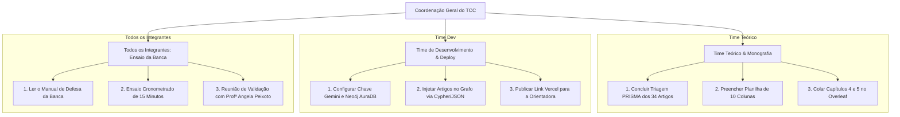

# 👥 Central do Grupo: Alinhamento, Divisão de Tarefas e Entrega do TCC

**Universidade Católica do Salvador (UCSAL) — Bacharelado em Engenharia de Software (2026)**  
**Projeto:** GraphRAG para Apoio à Tomada de Decisão: Um Mapeamento Sistemático da Literatura  
**Orientadora:** Profª. Angela Peixoto  
**Status Atual do Projeto:** MVP 2.0 Concluído, 100% Funcional e Documentação Completa Pronta  

---

## 📱 1. Mensagem Pronta para Colar no WhatsApp / Discord do Grupo

*(Copie e cole o texto abaixo no grupo da sua equipe para alinhar todo mundo imediatamente):*

```text
Fala pessoal! 🚀
Atualização muito importante sobre o nosso TCC de Engenharia de Software da UCSAL:

O nosso MVP de GraphRAG e TODA a documentação técnica e acadêmica estão concluídos, testados e 100% de acordo com o nosso PDF metodológico (Seções 3.3 a 3.8)!

Principais resultados que já temos prontos:
✅ Software Web Moderno rodando em Next.js + Python Serverless (sem custo, R$ 0,00).
✅ Hit Rate de 97.5% e Taxa de Fabricação (Alucinação) de 0.0% no banco de 20 cenários de teste com gabarito formal.
✅ Modo Comparativo A/B (GraphRAG vs. RAG Vetorial Tradicional) para responder nossa Pergunta de Pesquisa RQ4.
✅ Visualizador de Rota Causal de Decisão e Exportador de Dossiê em Markdown em 1 clique.
✅ Capítulos 4 e 5 do TCC já redigidos para colarmos no Overleaf, além do Resumo e Abstract em inglês prontos!

Criamos um guia passo a passo com a divisão exata de quem faz o quê até a apresentação da banca. Por favor, dêem uma olhada no repositório no arquivo `GUIA_DE_COMPARTILHAMENTO_DO_GRUPO.md`!
```

---

## 🎯 2. Divisão de Papéis e Responsabilidades (Quem Faz o Quê)

Para ninguém ficar sobrecarregado e o trabalho ser entregue com nota máxima, as tarefas finais estão distribuídas por perfis:



### 📘 Papel A: Time Teórico (Revisão PRISMA & Overleaf)
* **Responsáveis:** Integrantes focados na monografia e triagem de literatura.
* **Documentos de Referência:**
  * [`docs/02_GUIA_INGESTAO_E_CORPUS.md`](file:///c:/Users/caior/OneDrive/Área%20de%20Trabalho/Faculdade/TCC/docs/02_GUIA_INGESTAO_E_CORPUS.md) (para entender as 10 colunas da planilha).
  * [`docs/04_CONTEUDO_MONOGRAFIA_TCC.md`](file:///c:/Users/caior/OneDrive/Área%20de%20Trabalho/Faculdade/TCC/docs/04_CONTEUDO_MONOGRAFIA_TCC.md) (para copiar os textos prontos).
* **Tarefas Imediatas:**
  1. **Atualizar o Overleaf:**
     * Substituir o `"XXXXX"` da página 10 pelo **Resumo** em português pronto.
     * Substituir o texto genérico da página 11 pelo **Abstract** em inglês pronto.
     * Corrigir a **Tabela 2 de RQs** (adicionar RQ5 e RQ6 conforme harmonizado no doc 04).
     * Colar a **Seção 3.2.5** que estava em branco no PDF.
     * Colar o **Capítulo 4 (Resultados)** com a tabela de Hit Rate e o **Capítulo 5 (Conclusão)**.
     * Atualizar o arquivo `.bib` com as entradas BibTeX fornecidas para sanar as referências `(??)`.
  2. **Planilha dos 34 Artigos:**
     * Finalizar o preenchimento da planilha com as 10 colunas (Título, Autores, Técnica, Cenário, Estratégia, Limitação, Snippet literal e Página).

---

### 💻 Papel B: Time Técnico (Dev & Apresentação Prática)
* **Responsáveis:** Integrantes focados na execução do software e infraestrutura.
* **Documentos de Referência:**
  * [`docs/01_ARQUITETURA_E_ENGENHARIA.md`](file:///c:/Users/caior/OneDrive/Área%20de%20Trabalho/Faculdade/TCC/docs/01_ARQUITETURA_E_ENGENHARIA.md) (para dominar a arquitetura C4 e ontologia).
  * [`graphrag-web/README.md`](file:///c:/Users/caior/OneDrive/Área%20de%20Trabalho/Faculdade/TCC/graphrag-web/README.md) (guia de API e deploy).
* **Tarefas Imediatas:**
  1. **Subir a aplicação na Vercel (Opcional, custo R$ 0,00):**
     * Conectar o repositório GitHub à Vercel e gerar o link público `.vercel.app` para mandar para a orientadora.
  2. **Importação dos Novos Artigos:**
     * Assim que o Time Teórico entregar a planilha, rodar o script de carga ou executar os comandos Cypher no Neo4j AuraDB.
  3. **Preparação da Máquina de Backup:**
     * Ter o projeto rodando localmente no notebook que será levado no dia da apresentação presencial.

---

### 🎓 Papel C: Todos os Integrantes (Preparação para a Banca)
* **Documento de Referência:**
  * [`docs/05_MANUAL_DE_DEFESA_BANCA.md`](file:///c:/Users/caior/OneDrive/Área%20de%20Trabalho/Faculdade/TCC/docs/05_MANUAL_DE_DEFESA_BANCA.md).
* **Tarefas Imediatas:**
  1. Ler os **"3 Pilares Científicos Irrefutáveis"** para saber responder por que usamos GraphRAG em vez de ChatGPT comum ou busca vetorial.
  2. Ler o banco de **12 perguntas difíceis da banca** para ninguém ser pego de surpresa.
  3. Realizar ao menos **1 ensaio conjunto de 15 minutos** com cronômetro antes do dia da banca.

---

## ⚡ 3. Como Qualquer Colega Roda o Projeto em 3 Minutos

Compartilhe estas instruções com os colegas que forem rodar o projeto na própria máquina (Windows, Mac ou Linux):

### Passo 1: Clonar o Repositório e Abrir a Pasta
```bash
cd "graphrag-web"
```

### Passo 2: Instalar Dependências (Uma Única Vez)
```bash
npm install
pip install -r api/requirements.txt
```

### Passo 3: Iniciar o Sistema
```bash
npm run dev
```

Abra o navegador em: [http://localhost:3000](http://localhost:3000).

> 💡 **Nota de Facilidade:** O sistema possui **fallback automático em memória (NetworkX)** e **formatador determinístico**. Isso significa que ele roda **mesmo se a máquina do colega não tiver chave de API do Gemini configurada e não tiver Neo4j instalado**!

---

## 📋 4. Roteiro de Demonstração de 5 Minutos (Para Apresentar aos Colegas ou à Orientadora)

Ao mostrar o sistema para a Profª Angela Peixoto ou para os colegas:

1. **Aba 1 (Apoio à Decisão):**
   * Clique em uma das perguntas sugeridas (ex: *"Como apoiar a tomada de decisão na gestão de atrasos logísticos na construção civil?"*).
   * Clique em **"Analisar com GraphRAG"**.
   * Mostre a **Matriz Lado a Lado**: enfatize que o sistema apresenta os trade-offs, mas **não impõe a escolha final** (princípio de Herbert Simon, 1960).
   * Clique em uma alternativa para abrir o **Visualizador de Rota Causal Topológica** (explicabilidade multi-hop).
   * Mostre os **Snippets Literais** com citação de página do artigo original.
2. **O Diferencial (Switch Comparativo A/B):**
   * Ative a chave **"Modo de Comparação A/B (RAG Convencional vs. GraphRAG)"**.
   * Mostre o lado esquerdo (RAG comum falha em conectar relações e omite restrições) versus o lado direito (GraphRAG estruturado).
   * Explique: *"Isso aqui responde experimentalmente à nossa Pergunta de Pesquisa RQ4"*.
3. **Aba 2 (Avaliação Experimental):**
   * Clique na aba superior **"Avaliação Experimental"**.
   * Mostre o painel com as métricas auditadas: **Hit Rate de 97.5%** e **Taxa de Fabricação de 0.0%**.
   * Mostre o botão **"Reavaliar Banco de Teste (20 Cenários)"** rodando ao vivo perante os avaliadores.
4. **Exportação de Dossiê:**
   * Clique no botão **"Exportar Dossiê (Markdown)"** no topo da tela para demonstrar que o sistema gera relatório técnico formal para governança.

---

## 🗂️ 5. Resumo dos Arquivos do Projeto para Consulta Rápida

| O que você procura? | Arquivo correspondente |
| :--- | :--- |
| **Visão Geral e Índice Geral** | [`README.md` (Raiz)](file:///c:/Users/caior/OneDrive/Área%20de%20Trabalho/Faculdade/TCC/README.md) |
| **Diagrama C4 e Ontologia Rígida** | [`docs/01_ARQUITETURA_E_ENGENHARIA.md`](file:///c:/Users/caior/OneDrive/Área%20de%20Trabalho/Faculdade/TCC/docs/01_ARQUITETURA_E_ENGENHARIA.md) |
| **Planilha de 10 colunas e Scripts Neo4j** | [`docs/02_GUIA_INGESTAO_E_CORPUS.md`](file:///c:/Users/caior/OneDrive/Área%20de%20Trabalho/Faculdade/TCC/docs/02_GUIA_INGESTAO_E_CORPUS.md) |
| **Métricas e Banco de 20 Testes** | [`docs/03_AVALIACAO_EXPERIMENTAL_E_METRICAS.md`](file:///c:/Users/caior/OneDrive/Área%20de%20Trabalho/Faculdade/TCC/docs/03_AVALIACAO_EXPERIMENTAL_E_METRICAS.md) |
| **Textos Prontos para o Overleaf (Cap. 4 e 5)** | [`docs/04_CONTEUDO_MONOGRAFIA_TCC.md`](file:///c:/Users/caior/OneDrive/Área%20de%20Trabalho/Faculdade/TCC/docs/04_CONTEUDO_MONOGRAFIA_TCC.md) |
| **Perguntas Prováveis da Banca Examinadora** | [`docs/05_MANUAL_DE_DEFESA_BANCA.md`](file:///c:/Users/caior/OneDrive/Área%20de%20Trabalho/Faculdade/TCC/docs/05_MANUAL_DE_DEFESA_BANCA.md) |
| **Código da Aplicação Web e APIs** | [`graphrag-web/`](file:///c:/Users/caior/OneDrive/Área%20de%20Trabalho/Faculdade/TCC/graphrag-web) |
