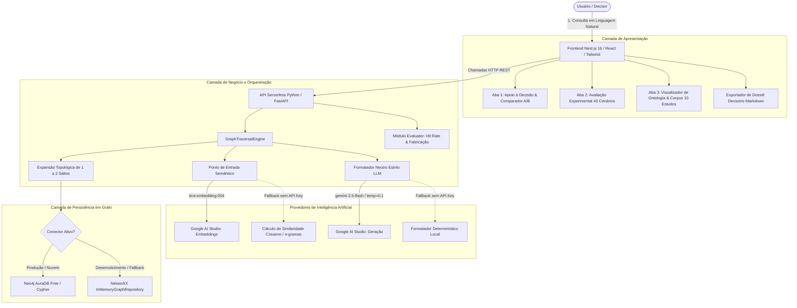
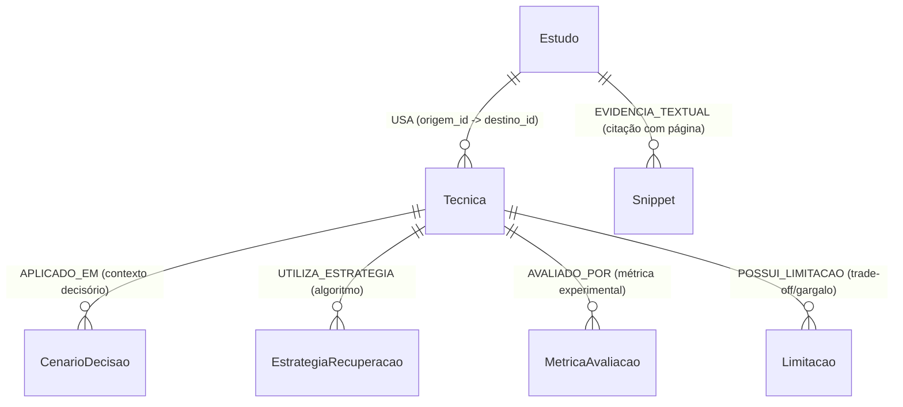
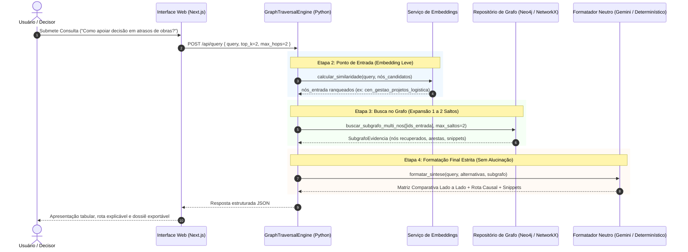

# 🏛️ Documento de Arquitetura e Engenharia de Software

**Projeto:** GraphRAG para Apoio à Tomada de Decisão: Um Mapeamento Sistemático da Literatura  
**Instituição:** Universidade Católica do Salvador (UCSAL) — Bacharelado em Engenharia de Software (2026)  
**Orientadora:** Profª Angela Peixoto  
**Autores:** Adriano Abreu de Almeida, Alison Andrade Rocha, Caio Roldão de Almeida Fonseca, Lívia Alves de Souza e Wendel Campos Bezerra  
**Referência Metodológica:** Capítulos 2 e 3 do documento monográfico do TCC (harmonizado em [04_CONTEUDO_MONOGRAFIA_TCC.md](file:///c:/Users/caior/OneDrive/Área%20de%20Trabalho/Faculdade/TCC/docs/04_CONTEUDO_MONOGRAFIA_TCC.md))

---

## 1. Visão Geral do Sistema

O sistema desenvolvido é uma plataforma web para apoio à tomada de decisão técnica fundamentada em literatura científica. Ao contrário de assistentes conversacionais baseados em recuperação vetorial tradicional (Naive RAG) — que recuperam fragmentos textuais desconexos e estão sujeitos a alucinações e perda de contexto relacional —, o sistema utiliza a abordagem **GraphRAG** guiada por uma **ontologia fixa rígida**.

O sistema cumpre com rigor epistemológico as fases do processo decisório de **Herbert Simon (1960)**:
1. **Fase de Inteligência:** Identificação e estruturação da dúvida decisória informada pelo usuário.
2. **Fase de Concepção:** Recuperação topológica das alternativas técnicas concorrentes, apresentadas lado a lado em matriz comparativa, acompanhadas de seus trade-offs, métricas e limitações comprovadas.
3. **Fase de Escolha:** Preservação estrita da autonomia humana. O sistema **não impõe e não recomenda uma escolha final**, cabendo exclusivamente ao decisor avaliar as evidências apresentadas.

---

## 2. Diagrama de Arquitetura de Componentes

O software adota uma arquitetura de monorepo moderno desacoplado, projetado para execução serverless de baixo custo (R$ 0,00) com fallback de alta disponibilidade:

---

## 3. Modelo Ontológico Rigoroso (Seção 3.5 do TCC)

A estrutura de dados obedece à **ontologia fixa pré-estabelecida** descrita na Seção 3.5 da monografia do TCC e implementada em [ontology.py](file:///c:/Users/caior/OneDrive/Área%20de%20Trabalho/Faculdade/TCC/graphrag-web/api/ontology.py):

### 3.1 Definição dos Tipos de Nós (`TipoNo`)

| Tipo de Nó | Descrição Acadêmica | Atributos Principais |
| :--- | :--- | :--- |
| **`Estudo`** | Artigo científico revisado por pares selecionado no processo PRISMA. | `id`, `nome` (título), `descricao`, `autores`, `ano`, `doi`, `instituicao`. |
| **`Tecnica`** | Abordagem técnica ou arquitetura de GraphRAG proposta pelos autores. | `id`, `nome`, `descricao`, `paradigma`. |
| **`CenarioDecisao`** | Situação ou problema prático em que a decisão precisa ser tomada. | `id`, `nome`, `descricao`, `foco` (domínio/área). |
| **`EstrategiaRecuperacao`**| Mecanismo de travessia ou algoritmo de busca no grafo. | `id`, `nome`, `descricao`. |
| **`MetricaAvaliacao`** | Métrica quantitativa ou qualitativa empregada para avaliar a técnica. | `id`, `nome`, `descricao`, `tipo`. |
| **`Limitacao`** | Custo computacional, gargalo ou contraindicação documentada no artigo. | `id`, `nome`, `descricao`, `tipo`. |
| **`Snippet`** | Citação textual literal extraída do corpo do PDF que comprova as afirmações. | `id`, `nome`, `descricao` (texto exato), `estudo_id`, `pagina`. |

### 3.2 Definição dos Tipos de Arestas (`TipoAresta`)

| Tipo de Aresta | Origem $\rightarrow$ Destino | Significado Semântico |
| :--- | :--- | :--- |
| **`USA`** | `Estudo` $\rightarrow$ `Tecnica` | O estudo científico propõe ou implementa a técnica de GraphRAG. |
| **`APLICADO_EM`** | `Tecnica` $\rightarrow$ `CenarioDecisao` | A técnica é adequada e validada para aquele cenário prático. |
| **`UTILIZA_ESTRATEGIA`** | `Tecnica` $\rightarrow$ `EstrategiaRecuperacao`| O algoritmo operacional utilizado pela técnica (ex.: Leiden, PPR, k-hop). |
| **`AVALIADO_POR`** | `Tecnica` $\rightarrow$ `MetricaAvaliacao` | Como a técnica foi mensurada na literatura primária (ex.: NDCG@5, Win-Rate). |
| **`POSSUI_LIMITACAO`** | `Tecnica` $\rightarrow$ `Limitacao` | Restrições explícitas assumidas ao adotar a abordagem. |
| **`EVIDENCIA_TEXTUAL`** | `Estudo` $\rightarrow$ `Snippet` | Vinculação literal auditável entre o estudo e seu trecho comprobatório. |

### 3.3 Escala e Topologia Atual do Grafo (10 Estudos Primários)

O grafo de conhecimento calibrado do MVP é constituído pelas seguintes entidades auditadas:
* **79 Nós Totais:**
  * 10 nós de `Estudo` (E01 a E10)
  * 10 nós de `Tecnica`
  * 10 nós de `CenarioDecisao` (cobrindo construção civil, nutrição, robótica, manufatura, transporte urbano, oleodutos, medicina clínica/TCM, recarga de VEs, O&M aeroespacial e UUVs)
  * 7 nós de `EstrategiaRecuperacao`
  * 10 nós de `MetricaAvaliacao`
  * 10 nós de `Limitacao`
  * 22 nós de `Snippet` (trechos literais com citação exata de página)
* **85 Arestas Direcionadas:** garantindo conectividade topológica estrita entre estudos, técnicas, cenários, estratégias, métricas, limitações e snippets literais.

---

## 4. O Pipeline de 4 Etapas (Seção 3.8 do TCC)

A orquestração do sistema espelha integralmente as 4 etapas da Seção 3.8 do documento metodológico:

---

## 5. Padrões de Projeto e Práticas de Engenharia Aplicadas

1. **Repository Pattern (`BaseGraphRepository`):**
   * Interface abstrata definida em [base.py](file:///c:/Users/caior/OneDrive/Área%20de%20Trabalho/Faculdade/TCC/graphrag-web/api/graph/base.py).
   * Permite desacoplar a lógica de negócio do banco de grafos subjacente.
   * Alterna dinamicamente entre [Neo4jGraphRepository](file:///c:/Users/caior/OneDrive/Área%20de%20Trabalho/Faculdade/TCC/graphrag-web/api/graph/neo4j_adapter.py) e [InMemoryGraphRepository](file:///c:/Users/caior/OneDrive/Área%20de%20Trabalho/Faculdade/TCC/graphrag-web/api/graph/inmemory_adapter.py) com tolerância a falhas.

2. **Strict LLM Grounding (Garantia de 0% de Fabricação):**
   * O LLM nunca recebe instruções para "pensar livremente" ou responder perguntas fora do subgrafo.
   * O prompt injeta o contexto serializado em JSON e proíbe terminantemente deduções fora dos nós e arestas recuperados.
   * A temperatura de amostragem é fixada em `0.1`, minimizando a estocasticidade.

3. **Multi-Hop Explainability (Rota Causal Topológica):**
   * Cada alternativa recomendada reconstrói o caminho de grafos que a justificou:
     $$\text{Cenário} \rightarrow \text{Técnica} \rightarrow \text{Estratégia} \rightarrow \text{Métrica} \rightarrow \text{Limitação} \rightarrow \text{Snippet}$$
   * Permite que auditores ou bancas examinadoras inspecionem visualmente por que uma técnica foi sugerida.
